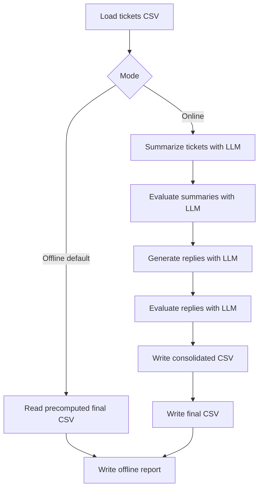

# Support Ticket Intelligence (Offline-First)

This project demonstrates a support-ticket intelligence pipeline:
- Summarize raw tickets
- Evaluate summary quality
- Generate customer-facing replies
- Evaluate reply quality
- Export consolidated CSV outputs

By default it runs **offline** (no API calls) using the precomputed outputs in `outputs/`.

## Project Structure

- `data/support_ticket_data.csv`: input tickets
- `outputs/consolidated_ticket_outputs.csv`: ticket + summary + reply
- `outputs/final_consolidated_ticket_outputs.csv`: consolidated output + evaluation columns (when available)
- `reports/Full_code_Support_Ticket_Analysis.html`: exported report from the original notebook
- `run_pipeline.py`: CLI entrypoint
- `support_ticket_ai/`: pipeline modules

## Flow Diagram



## Run (Offline)

```bash
.venv/bin/python run_pipeline.py --offline
```

This creates `outputs/offline_report.md` and does **not** require any API key. If you don't have a virtualenv, install deps first:

```bash
python3 -m pip install -r requirements.txt
python3 run_pipeline.py --offline
```

## Run (Online / Regenerate Outputs)

1) Install dependencies:

```bash
python3 -m pip install -r requirements.txt
```

2) Create `config.json` (do not commit it):

```bash
cp config.example.json config.json
```

3) Run:

```bash
python3 run_pipeline.py --online --config config.json
```

Optional for quick tests:

```bash
python3 run_pipeline.py --online --config config.json --limit 5
```

## GitHub Best Practices (for sharing)

- Never commit secrets: keep `config.json` ignored and share only `config.example.json`.
- Prefer an offline-by-default demo: commit small sample data and precomputed outputs so anyone can run it.
- Add clear instructions: how to run offline vs online, what files are generated, and what the outputs mean.
